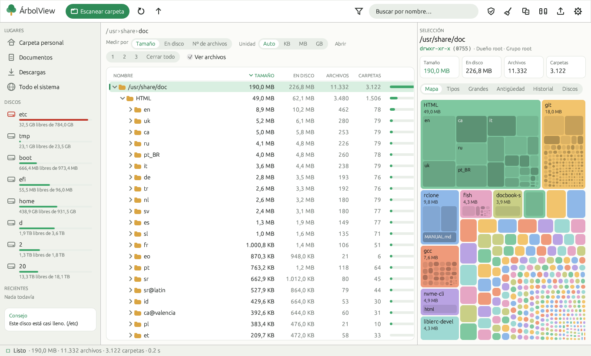

# ÁrbolView

**Mira qué carpetas llenan tus discos** — un analizador de espacio en disco rápido para
**Linux, Windows y macOS**, con árbol de carpetas, mapa de bloques, historial y limpieza.

*See which folders fill your disks — a fast disk usage analyzer for Linux, Windows and macOS.
[English below](#english).*



## Descargar

En **[Releases](https://github.com/AsturTorQue/ArbolView/releases)** están los binarios de
cada versión:

| Sistema | Archivo | Cómo abrirlo |
|---|---|---|
| Linux Intel/AMD | `ArbolView-<versión>-x86_64.AppImage` | `chmod +x ArbolView-*.AppImage` y doble clic |
| Linux ARM (Raspberry Pi 4/5…) | `ArbolView-<versión>-aarch64.AppImage` | igual |
| Windows Intel/AMD | `ArbolView-<versión>-windows-x64.zip` | Descomprimir y abrir `ArbolView.exe` (no se instala) |
| Windows ARM (Snapdragon, Surface…) | `ArbolView-<versión>-windows-arm64.zip` | igual |
| macOS Apple Silicon e Intel | `ArbolView-<versión>-macOS.dmg` (universal) | Arrastrar ÁrbolView a Aplicaciones. La primera vez: clic derecho ▸ Abrir |

> En macOS la app no está firmada por Apple, por eso la primera vez hay que abrirla con
> clic derecho ▸ Abrir (o en Ajustes ▸ Privacidad y seguridad ▸ «Abrir igualmente»).
> En Windows SmartScreen puede avisar: «Más información» ▸ «Ejecutar de todas formas».

### Si no abre

- La app muestra un aviso con el motivo y guarda los detalles en `crash.log`:
  Windows `%APPDATA%\arbolview\crash.log`, Linux `~/.local/share/arbolview/crash.log`,
  macOS `~/Library/Application Support/arbolview/crash.log`.
- Casi siempre son los controladores gráficos: actualízalos.
- Para forzar el modo de dibujo: variable `ARBOLVIEW_RENDERER=glow` (OpenGL) o
  `ARBOLVIEW_RENDERER=wgpu` (Direct3D/Vulkan/Metal).

## Qué hace

- **Árbol de carpetas** ordenado por tamaño, con tamaño real en disco, archivos, carpetas,
  peso relativo, fecha, dueño y permisos.
- **Mapa de bloques**, tipos de archivo, archivos más grandes y antigüedad.
- **Historial**: cada escaneo se guarda y una gráfica muestra cómo crece cada carpeta;
  **escaneos programados** cada hora, día o semana aunque la app esté cerrada.
- **Gestión**: enviar a la papelera con deshacer, **buscar duplicados**, **limpieza rápida**
  (cachés, papelera, temporales…), comparar dos carpetas y **filtros** por tamaño, antigüedad
  y tipo.
- **Informes** en PDF, HTML, CSV y JSON.
- **Línea de comandos** para scripts: `arbolview scan`, `history`, `schedule`.
- Modo **root / administrador**, enlaces simbólicos sin contar dos veces, enlaces duros una
  sola vez, sin cruzar a otros discos.
- 4 idiomas (español, English, português, français) y 6 temas.

## Línea de comandos

```sh
arbolview scan ~ --format pdf -o ~/informe.pdf      # informe en PDF
arbolview scan / --format json --depth 3            # datos para otros programas
arbolview scan /srv --warn-free 10 --quiet || echo "¡Disco casi lleno!"   # código 3 si <10 % libre
arbolview history ~                                 # evolución en el tiempo
arbolview schedule add ~ --every daily              # escaneo diario programado
arbolview --help
```

En Windows se usa igual desde una terminal: `ArbolView.exe scan C:\Users\yo --format html`.

## Compilar

Hace falta [Rust](https://rustup.rs) (estable).

```sh
cargo build --release        # el programa queda en target/release/arbolview
cargo test                   # pruebas
```

Paquetes de cada sistema: ver [`packaging/README.md`](packaging/README.md).

### Publicar una versión

1. Cambia `version` en `Cargo.toml` y anota los cambios en `CHANGELOG.md`.
2. `git commit -am "Versión 0.3.1"` y `git tag v0.3.1`
3. `git push && git push --tags`

GitHub Actions compila Linux, Windows y macOS y publica los tres archivos en *Releases*.
Cada `push` también comprueba que el código compila y pasa las pruebas en los tres sistemas.

---

## English

ÁrbolView shows which folders take up space: a size-sorted folder tree, a tree map, file
types, largest files, file age, history with scheduled scans, trash with undo, duplicate
finder, quick clean-up, folder comparison, filters, PDF/HTML/CSV/JSON reports and a command
line (`arbolview --help`). Downloads for Linux (AppImage), Windows (zip) and macOS (dmg) are
on the [Releases](https://github.com/AsturTorQue/ArbolView/releases) page.

Build with `cargo build --release`. To publish a release, bump the version in `Cargo.toml`,
tag it (`git tag v0.3.1`) and push the tag: the workflow builds and uploads all three
packages.

## Licencia / License

[MIT](LICENSE)
